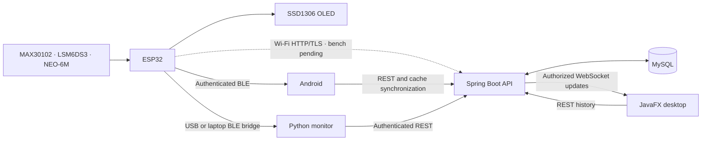
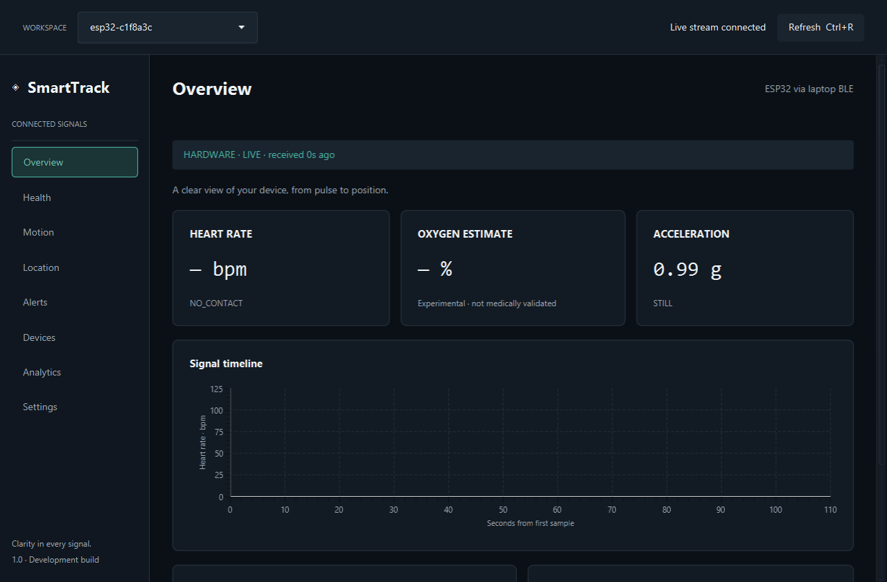
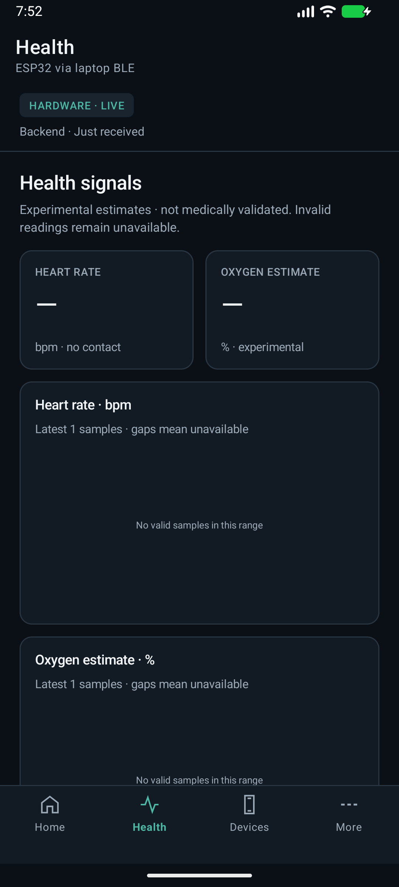

# SmartTrack

**IoT health, motion and GPS monitoring with ESP32, JavaFX, Android and Spring Boot.**

SmartTrack brings sensor readings, connection status and recorded history into one platform. An ESP32 collects optical, inertial and GPS data, shows local status on an OLED, and provides Wi-Fi, Bluetooth Low Energy (BLE) and USB transport. Java desktop and Android clients display readings through a shared telemetry contract; Spring Boot handles accounts, device ownership, ingestion and MySQL storage.

Developed for **Advanced Java Programming, SRM University-AP**. This is an engineering prototype. Heart-rate/SpO₂ estimates and fall detection are experimental; the project is not a medical device or an emergency service.

## Implementation status

| Area | Current evidence / limit |
|---|---|
| ESP32 | Firmware `1.1.1-dev`; sensor initialization, paired optical acquisition and idle emitter control tested |
| Motion and GPS | Real motion frames and GPS communication/fix observed; accuracy and extended bench tests remain pending |
| Optical measurements | Stable, reference-validated SpO₂ has **not** been obtained; later checks also recorded a sensor timeout |
| BLE / USB / backend | Actual phone BLE, account sharing and concurrent PC USB readings verified on the earlier `1.1.0-dev` transport baseline |
| Direct ESP32 Wi-Fi | HTTP/verified-TLS worker implemented; a complete direct-device Wi-Fi bench remains unverified |
| OLED | SSD1306 128×64 driver and quadrant test implemented; photographed full-panel verification pending |
| JavaFX | Eight views and asynchronous API access; the unsigned native Windows launcher is blocked by Smart App Control on the development laptop |
| Android | Native Java app `1.1.0`, foreground BLE, backend access, encrypted cache and CSV export; no guaranteed background BLE service |

See [test results](docs/TEST_RESULTS.md), the [connection baseline](docs/CONNECT_AND_SHARE_1_1_0.md), [latest pulse investigation](docs/PULSE_FIX_1_1_1.md) and [known limitations](docs/KNOWN_LIMITATIONS.md). Saved bench results describe their recorded versions, rather than guaranteeing every later build or device.

## Architecture



Snapshots carry device, boot-session and sequence identity, UTC time provenance, measurement validity and `HARDWARE` / `SIMULATOR` source. Identical retries return the original record; conflicting retries are rejected. The backend checks ownership and publishes live events after transaction commit. Android reads backend data through REST; the JavaFX client uses REST and WebSocket updates. Clients never connect directly to MySQL.

The design is explained in [architecture decisions](docs/ARCHITECTURE_DECISIONS.md), the [JSON Schema](shared-contracts/telemetry-v1.schema.json), [OpenAPI contract](shared-contracts/openapi.yaml) and [BLE protocol](docs/BLE_PROTOCOL.md).

## Hardware

| Component | Purpose | Firmware connection |
|---|---|---|
| ESP32 DevKit V1 | Acquisition and wireless controller | PlatformIO `esp32doit-devkit-v1` |
| MAX30102 | Red/infrared optical acquisition | I²C `0x57` |
| GY-LSM6DS3 | Acceleration and gyroscope | I²C `0x6B` |
| NEO-6M GPS | Position and UTC | UART 9600 baud; GPS TX → GPIO26; GPIO27 → GPS RX optional |
| SSD1306 OLED | Local status, clock and pairing code | I²C `0x3C`, 128×64 |

I²C uses GPIO21 (SDA) and GPIO22 (SCL), with common ground. Check the exact carrier's supply rating and 3.3 V logic compatibility before wiring; a breakout's VIN label does not establish 5 V tolerance. See [wiring and bench checks](docs/HARDWARE.md) and the [firmware guide](firmware/esp32/README.md).

## Technology stack

| Layer | Project configuration |
|---|---|
| Backend | Java 21, Spring Boot 3.5.7, Spring Security, REST, WebSocket, JDBC/JPA |
| Database | MySQL 8.0, Flyway migrations; H2 for isolated tests/development |
| Desktop | Java 21, JavaFX 21.0.9, HttpClient, virtual threads, CompletableFuture |
| Android | Java 17 source level, SDK 36 / minimum API 26, AGP 8.10.1, Gradle 8.13, Room, Retrofit/OkHttp, Keystore |
| Firmware | Arduino C++, PlatformIO Core 6.1.18, Espressif32 6.10.0, pinned sensor/BLE libraries |
| Tooling | Maven 3.9.11, Python 3.11+, PowerShell; optional JDK `jpackage` and WiX 3 for Windows installers |

The canonical contract targets Java 17 for reuse by Android. Backend and desktop target Java 21.

## Installation and local development

The supplied automation targets **Windows**. Install Git, Python 3.11+, MySQL Server 8.0 binaries and, for Android, SDK 36 and Platform Tools. Install the appropriate USB driver for your ESP32 board. MySQL and Android SDK are separate prerequisites; no SDK, database or downloaded toolchain is committed.

### 1. Set up build tools

From the repository root in PowerShell:

```powershell
powershell -NoProfile -ExecutionPolicy Bypass -File scripts/bootstrap-tools.ps1
powershell -NoProfile -ExecutionPolicy Bypass -File scripts/build.ps1
```

Bootstrap downloads checksum-verified JDK 21, Maven 3.9.11 and Gradle 8.13 archives under `.tools/`, and creates `.tools/pio-env` using [requirements-dev.txt](requirements-dev.txt). Internet access is required for first-time downloads. The build runs the Java reactor's tests and creates the backend JAR and JavaFX classpath dependencies.

Alternatively, install those tool versions yourself, set `JAVA_HOME` to JDK 21, and make Maven/Gradle available on PATH. The scripts prefer local `.tools` installations. PowerShell's `-ExecutionPolicy Bypass` applies to that invocation; it does not change machine policy.

### 2. Start the backend and database

For a local, hardware-only development backend:

```powershell
.\Start-Backend.cmd -BindAddress 127.0.0.1
```

The launcher creates or reuses an **isolated workspace MySQL instance** under `.tools/mysql-data` on `127.0.0.1:3317`, loads randomly generated local credentials from ignored `.work/mysql-credentials.json`, and starts the API on port **8087**. It does not seed simulator data. MySQL binaries default to `C:\Program Files\MySQL\MySQL Server 8.0`; `scripts/start-local-mysql.ps1 -MySqlHome <path>` supports another installation. Flyway loads [database/V1__platform.sql](database/V1__platform.sql) from the backend's packaged resources.

Check readiness at `http://127.0.0.1:8087/actuator/health` and identity at `http://127.0.0.1:8087/v1/info`. Sign in or create an account in either client; registration requires a password of at least 12 characters. Logs and PID files stay under `.work/`. The launcher reuses an identified running workspace backend; use `-Restart` to apply a changed build or binding. It keeps running after its launcher window closes.

For an existing MySQL installation instead, create a dedicated database/user, set `SMARTTRACK_DB_URL`, `SMARTTRACK_DB_USER` and `SMARTTRACK_DB_PASSWORD`, then run `scripts/start-backend.ps1`. The direct Spring Boot default port is **8080**; set `SMARTTRACK_PORT=8087` to match the clients. [`.env.example`](.env.example) documents the variables with no credentials. Neither Spring Boot nor these scripts automatically loads a `.env` file; set variables in the process environment. Do not reuse production databases for verification scripts.

For an explicitly simulated demonstration using the isolated MySQL instance, stop the hardware backend first, then run:

```powershell
$env:SMARTTRACK_BIND = '127.0.0.1'
powershell -NoProfile -ExecutionPolicy Bypass -File scripts/start-demo.ps1
```

This creates a private generated account/session in `.work/demo-session.json` and ingests 20 labelled `SIMULATOR` snapshots. It refuses an occupied API port. `scripts/start-backend.ps1 -Demo` is a separate **H2** development option, not a MySQL test. To stop the recorded workspace backend/database, use `scripts/stop-demo.ps1`.

### 3. Run the JavaFX desktop

After the Java build and backend startup:

```powershell
powershell -NoProfile -ExecutionPolicy Bypass -File scripts/start-desktop.ps1
```

Enter `http://127.0.0.1:8087` and sign in. For the simulated demo, the generated credentials are available only in your local `.work/demo-session.json`. The application provides overview, health, motion, location, alerts, devices, analytics and settings views, bounded history and CSV export. `scripts/package-windows.ps1` builds a local app image; installer creation additionally requires WiX 3 and appropriate release signing. Running the JavaFX classpath is separate from executing an unsigned native launcher.

### 4. Build and connect Android

Set `ANDROID_HOME` to your SDK location, or use the Windows default `%LOCALAPPDATA%\Android\Sdk`. Install SDK platform 36, the build tools requested by Gradle, and accept SDK licences.

```powershell
powershell -NoProfile -ExecutionPolicy Bypass -File scripts/build-android.ps1
```

This runs the debug build, JVM tests and lint. Install `android/app/build/outputs/apk/debug/app-debug.apk` using Android Studio or `adb install -r <apk-path>`. APKs are generated locally and excluded from Git.

| Client / transport | Development backend address |
|---|---|
| Desktop | `http://127.0.0.1:8087` |
| Android emulator | `http://10.0.2.2:8087` |
| USB-connected physical phone | Run `Connect-Phone-USB.cmd`, then use `http://127.0.0.1:8087` while USB forwarding remains active |
| Physical phone over Wi-Fi | Use the laptop's current LAN address and a deliberately enabled LAN listener/firewall rule |

USB forwarding requires USB debugging and accepting the phone's authorization prompt. Without `-BindAddress`, `Start-Backend.cmd` currently binds port 8087 on all interfaces; choose this only for a controlled LAN bench. `Enable-Phone-Access.cmd` requires administrator rights to add the project firewall rule. It is optional and is not run during builds. Local HTTP exposes account traffic; use HTTPS for deployment. Debug Android permits HTTP; release builds require HTTPS and an external signing keystore.

For direct sensor monitoring, enable Bluetooth and choose **Connect nearby ESP32** in the app's Devices view. Pair with the OLED code. The phone can display BLE data without backend sign-in; linking/sharing requires an account. BLE supports one central client at a time. USB monitoring can operate alongside phone BLE.

### 5. Build and upload ESP32 firmware

```powershell
powershell -NoProfile -ExecutionPolicy Bypass -File scripts/build-firmware.ps1
# Replace COM5 with your board's actual USB serial port.
powershell -NoProfile -ExecutionPolicy Bypass -File scripts/build-firmware.ps1 -Upload -Port COM5
```

Register a device in SmartTrack, then provision its identity, Wi-Fi settings and device token privately over serial using the [firmware guide](firmware/esp32/README.md). No Wi-Fi password or device token is embedded in source. Keep provisioning files and raw recordings outside the repository or under `.work/`.

For PC monitoring after bootstrap:

```powershell
.\Connect-ESP32-USB.cmd
.\Connect-ESP32-Bluetooth.cmd
```

Add `--backend http://127.0.0.1:8087` to a monitor to forward authenticated hardware readings. A full direct ESP32 Wi-Fi bench is still pending; the phone/laptop bridge path has separate recorded evidence.

## Verification

```powershell
# Contract, backend H2 integration and desktop unit tests:
powershell -NoProfile -ExecutionPolicy Bypass -File scripts/build.ps1
# Python schema, USB decoder and BLE fragmentation tests:
.\.tools\pio-env\Scripts\python.exe -m unittest discover -s tests -p "test_*.py" -v
# Android debug build + JVM tests + lint:
powershell -NoProfile -ExecutionPolicy Bypass -File scripts/build-android.ps1
# ESP32 cross-compilation:
powershell -NoProfile -ExecutionPolicy Bypass -File scripts/build-firmware.ps1
```

`scripts/verify-mysql.ps1` runs backend integration tests against the isolated MySQL instance. `scripts/verify-desktop.ps1` needs the running simulator demo/session. `scripts/verify-android-device.ps1` runs instrumentation on an authorized emulator/device and requires the appropriate test backend; use a disposable app profile because these tests change client settings and create test accounts. Physical BLE/USB harnesses require actual hardware and explicit device arguments. See [test instructions](tests/README.md) and the [hardware checklist](tests/HARDWARE_CHECKLIST.md).

Historical reports record 17 Java checks, 8 Android JVM checks, 3 emulator journeys and 14 Python checks, plus an earlier 5-test MySQL suite. Those counts describe saved runs, not a claim that all physical and release gates pass. Raw logs, credentials, user telemetry and database files remain private.

## Screenshots

Project-owned development captures are retained under [`docs/ui/`](docs/ui/). Missing health values are intentional: these captures do not demonstrate validated SpO₂.

**JavaFX with real hardware data through the laptop bridge and backend (development 1.0.2):**



**Android emulator health view receiving real hardware data through the backend (development 1.0.2):**



These are recorded development states, not fabricated dashboards or evidence that the unsigned Windows launcher executes. Other screenshots labelled `SIMULATED` use test fixtures.

## Repository layout

```text
android/             Native Java Android client, resources and tests
backend/             Spring Boot API, authentication, telemetry and tests
database/            Flyway SQL migrations (packaged by backend/pom.xml)
desktop/             JavaFX application, CSS and tests
firmware/esp32/      PlatformIO configuration, C++ source and native tests
shared-contracts/    Shared Java records, JSON Schema, OpenAPI and simulator fixture
design-system/       Design specification, tokens and required application icon assets
scripts/             Tool bootstrap, build, run, connection and packaging scripts
tests/               Python contract/transport tests and hardware checklist
docs/                Architecture, wiring, security, test evidence and screenshots
.env.example         Safe environment-variable reference
requirements-dev.txt Pinned direct Python development dependencies
pom.xml              Java multi-module Maven build
```

`.tools/`, `.work/`, `dist/`, module build directories, local IDE settings, keys, logs and database state are ignored. Generated university reports/presentations remain local because they contain personal details and are not build inputs. Necessary assets, source fixtures and configuration examples remain in Git. Keep versioned migrations; do not commit SQL dumps containing user data.

## Security and publication

The application uses owner-scoped authorization, BCrypt password hashes and hashed bearer credentials. Android encrypts cache payloads and credentials with Keystore. These controls do not make the prototype production-ready: hosted TLS, rate limits, account recovery, signing and further hardware validation remain work. Read [security and privacy](docs/SECURITY.md) and [release instructions](docs/RELEASE.md).

Do not commit `.env` values, Wi-Fi passwords, tokens, signing keys, account exports or raw health/location records. `.gitignore` cannot remove secrets already staged or committed; inspect the actual index before every publication. See [GitHub publication guide](docs/GITHUB_PUBLISHING.md). No licence has been chosen for this project; no open-source licence is implied.
