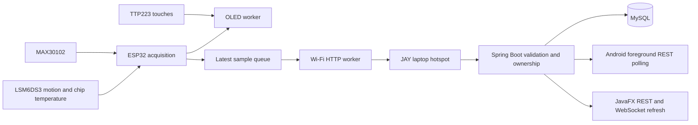

# System architecture

Authenticated UDP discovery on port 49001 avoids compiling a server IP. The device-key HMAC signs a nonce-bound response. HTTP ingestion uses X-Device-Key; user apps use HTTP Basic authentication. The private laptop hotspot carries unencrypted local HTTP. The backend binds to its hotspot address, TCP8080. MySQL uses loopback3308.

A reading has device/boot/sequence identity, capture and receive times, simulation flag and health, motion and temperature channels. Backend transactions and a unique key suppress duplicate retries. Post-commit notifications refresh JavaFX. Android polls every 3 seconds while active. Both clients mark old data historical and use the same database.

Temperature has its own V4 Flyway table and is independent of motion calibration. No historical temperatures are invented or backfilled. Applied V1-V3 migrations and old location history remain immutable for existing installations, but no active location service, controller, library or client screen remains. Defaults disable simulation. Chip temperature cannot establish body temperature or fever.
